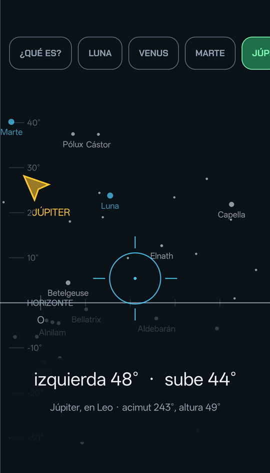
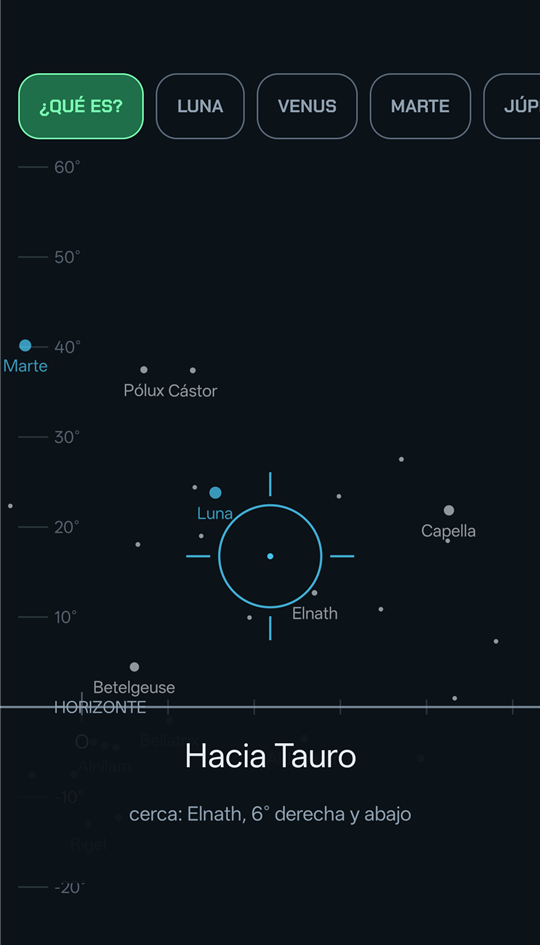
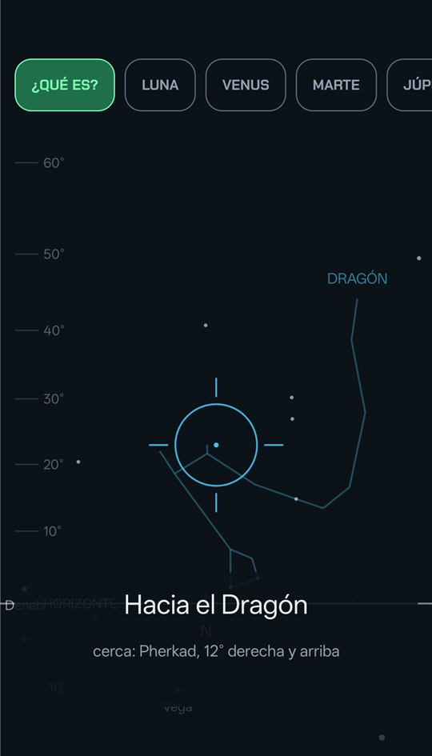
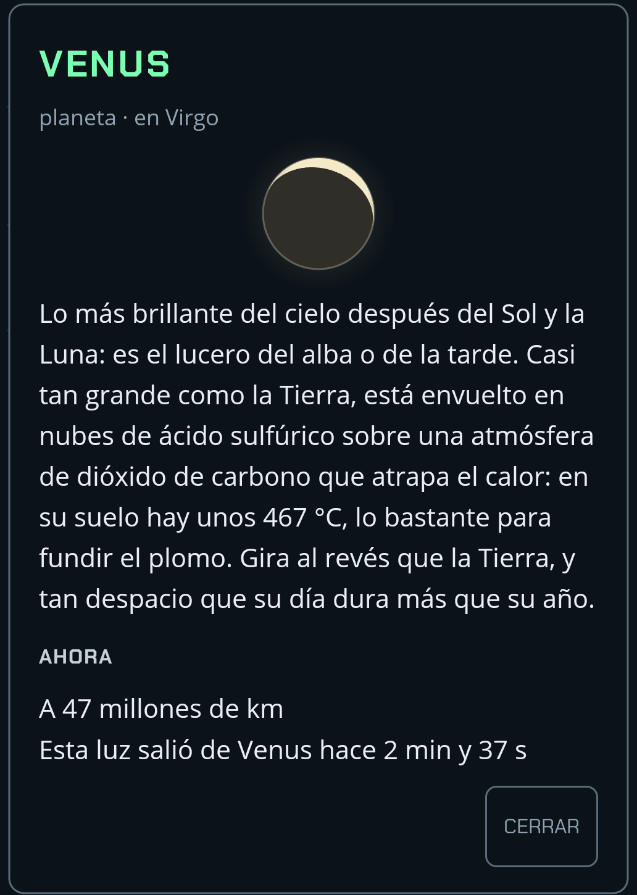
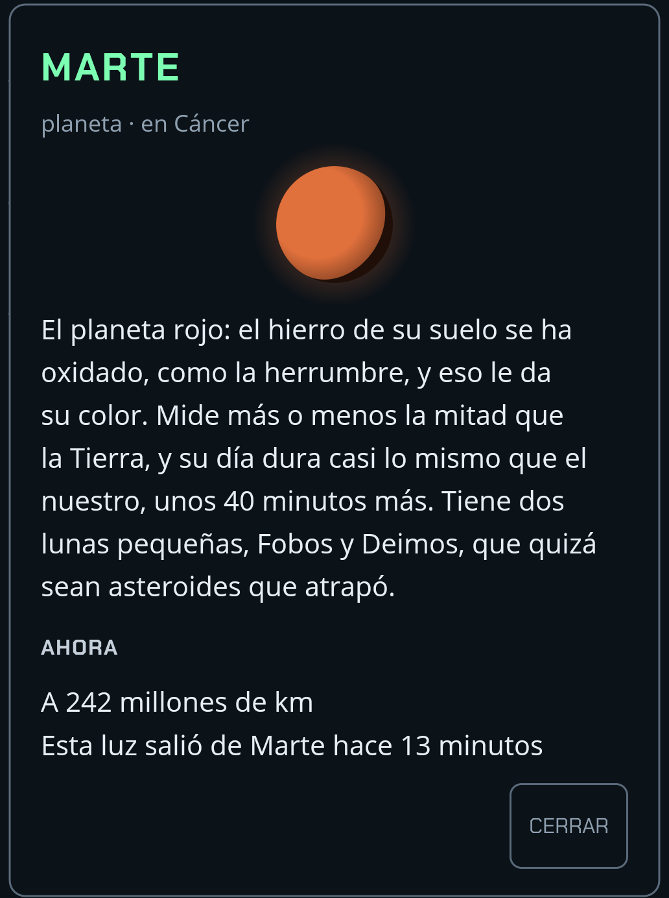
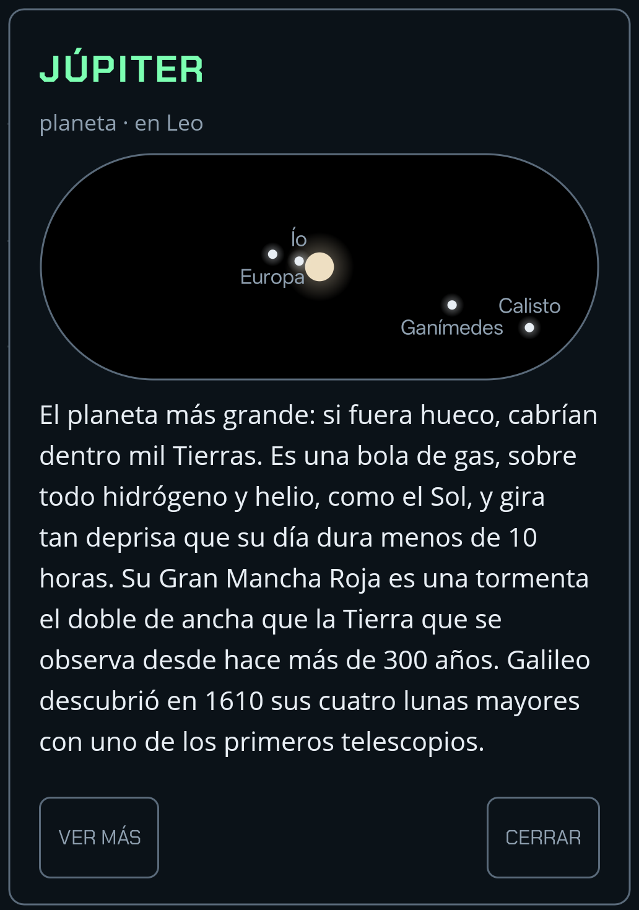

  

<h1 align="center">CieloHud</h1>

  <b>Una gincana mirando hacia arriba.</b> 
  Levantas el móvil, un HUD te guía hasta la Luna, un planeta, la Estación Espacial o una estrella, y lo miras con tus propios ojos.

---

Aquí están las versiones para instalar en Android. El código no es público.

## Qué es

CieloHud responde a dos preguntas, con el móvil en la mano y sin escribir nada:

- **«¿Dónde está?»** Eliges Saturno y la app te dice *«izquierda 48° · sube 44°»* hasta que la retícula se pone verde: **AQUÍ**. Bajas el móvil y ahí está.
- **«¿Qué es eso?»** Apuntas a un punto brillante y te dice *«BETELGEUSE · estrella · en Orión»*. Si no hay nada conocido, al menos te dice hacia qué constelación miras y qué tienes cerca.

Cuando lo encuentras, una **ficha** te cuenta qué estás viendo, con un dibujo calculado para ese momento: la Luna o Venus con su fase y girados como en el cielo, Júpiter con sus lunas en su sitio, Saturno con la inclinación de sus anillos.

Además te **avisa** cuando pasa la ISS por encima y se va a ver, cuando la Luna está junto a un planeta o dos planetas se ven juntos, y en los mejores días para ver Mercurio. Con **NOCHE**, todo pasa a rojo y con poco brillo para no deslumbrarte.

  
  &nbsp;
  
  &nbsp;
  

Modo guía hacia Júpiter · modo «¿qué es?» · figura de la constelación bajo la retícula.

  
  &nbsp;
  
  &nbsp;
  

## Instalar en tu móvil

1. Desde el móvil (Android 8.0 o posterior), descarga el APK de la [última versión](https://github.com/victorvalenciamunoz/CieloHud/releases) (abajo, en *Assets*) y ábrelo. Si ya tienes una versión anterior, se actualiza sin perder tus ajustes.
2. Android pedirá permiso para instalar apps de origen desconocido. Play Protect puede avisar de que no conoce la app: es normal en una app que no está en Google Play («Instalar de todas formas»).
3. Al abrirla pedirá la **ubicación**: sirve para calcular tu cielo y no sale del móvil. Si activas **AVISOS**, también las **notificaciones** y, para que el aviso llegue a su hora, «Alarmas y recordatorios».

En móviles que cierran las apps para ahorrar batería (OPPO, Xiaomi, Huawei…) conviene permitirle la actividad en segundo plano, o los avisos pueden no llegar.

## Datos

Todo se calcula en el móvil: no hay cuentas, servidores ni anuncios; solo se descarga la órbita de la ISS desde
[CelesTrak](https://celestrak.org). Los cálculos se han contrastado con [JPL Horizons](https://ssd.jpl.nasa.gov/horizons/),
[Stellarium](https://stellarium.org) y [Heavens-Above](https://www.heavens-above.com). Las licencias de terceros están en
[`THIRD-PARTY-NOTICES.md`](THIRD-PARTY-NOTICES.md).
