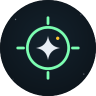
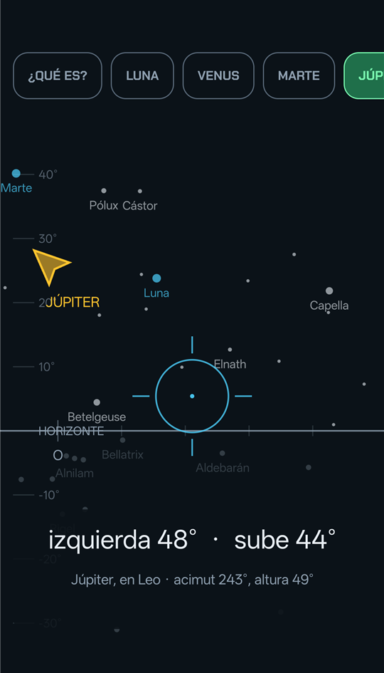
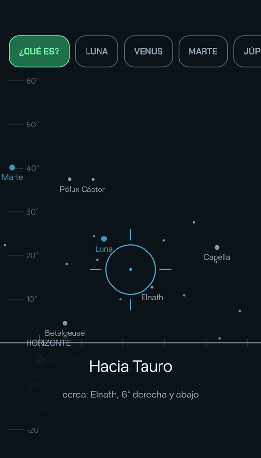
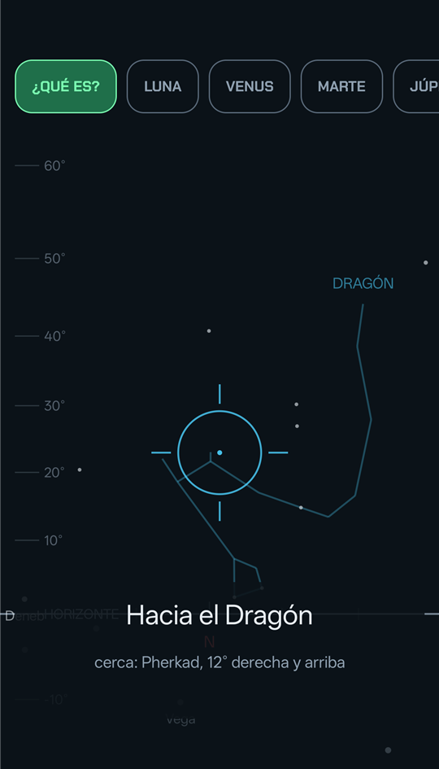
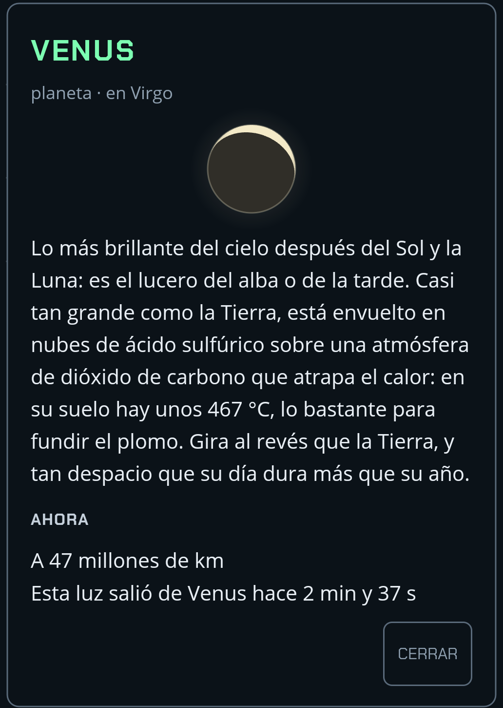
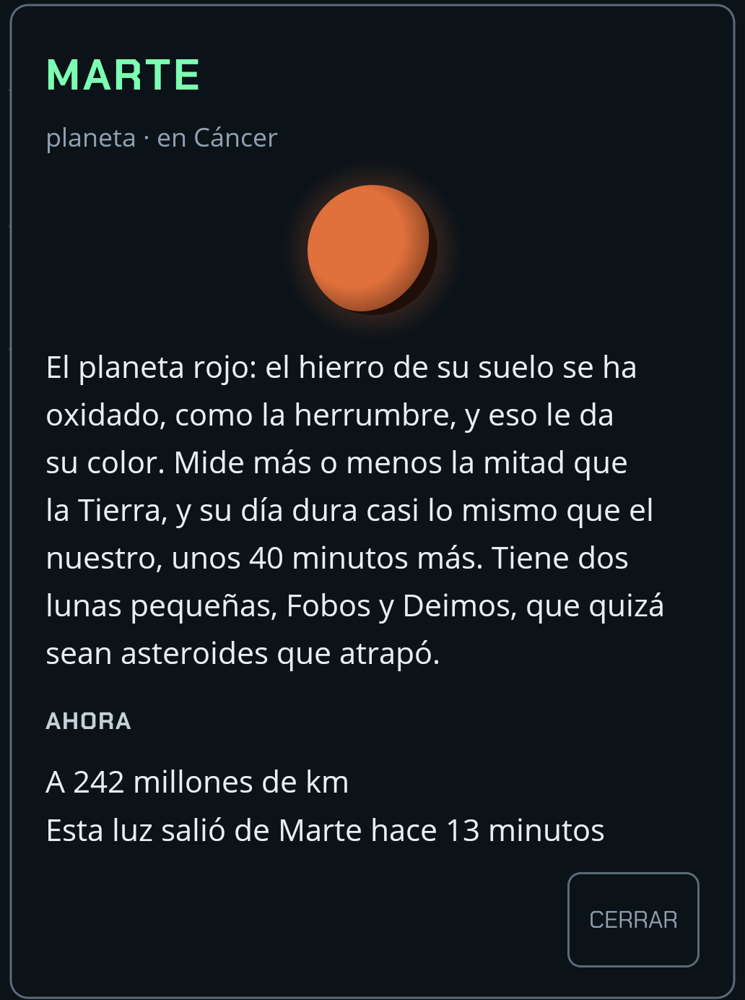
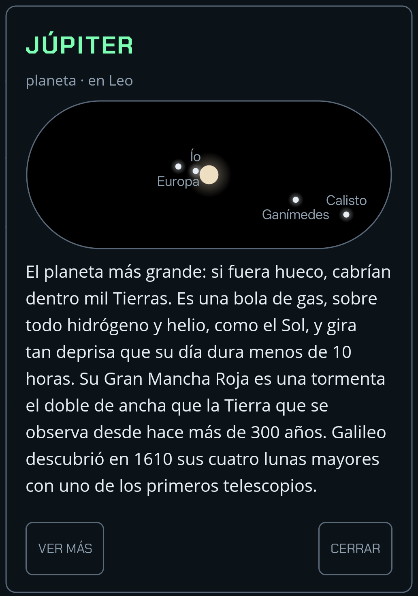
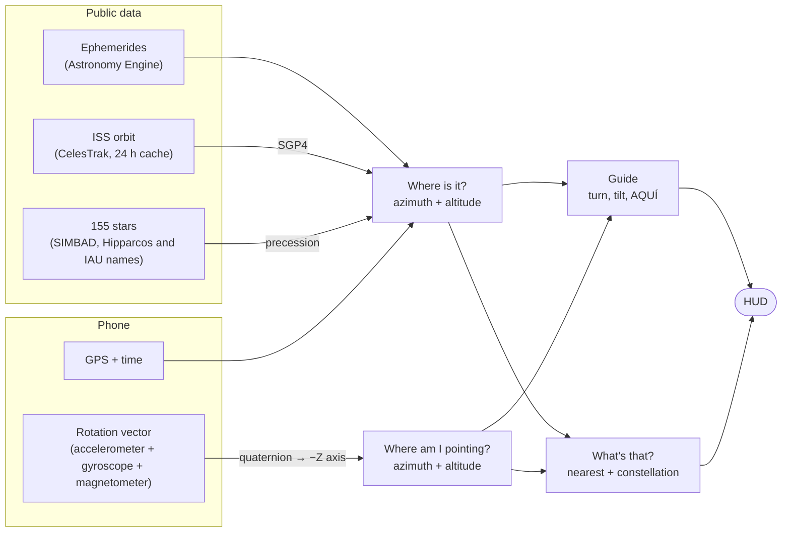

<p align="center">
  
</p>

<h1 align="center">CieloHud</h1>

<p align="center">
  <b>A scavenger hunt, looking up.</b><br/>
  Raise your phone and a HUD guides you to the Moon, a planet, the Space Station or a star, so you can see it with your own eyes.
</p>

<p align="center">
  <b>English</b> · <a href="README.es.md">Español</a>
</p>

<p align="center">
  
  
  <a href="https://github.com/victorvalenciamunoz/CieloHud/actions/workflows/ci.yml"></a>
  
  
  <a href="LICENSE"></a>
</p>

> **Language note.** The app, the texts of its cards and the project documentation in [`docs/`](docs/) are in Spanish.
> This README is the English entry point; [`README.es.md`](README.es.md) is the Spanish one. The app's labels are quoted
> as they appear on screen (AQUÍ, NOCHE, AVISOS…), with a translation the first time.

---

## What it is

CieloHud answers two questions, phone in hand and without typing anything:

- **"Where is it?"** Pick Saturn and the app says *"izquierda 48° · sube 44°"* (left 48°, up 44°) until the reticle turns green: **AQUÍ** (here). Lower the phone and there it is. A star works the same way: ESTRELLAS (stars) suggests the brightest ones right now, or you search for one by name.
- **"What's that?"** Point at a bright dot and it tells you *"BETELGEUSE · estrella · en Orión"* (a star in Orion). If there is nothing known there, it at least tells you which constellation you are looking at and what is nearby.

Once you find it, a **card** tells you what you are looking at, with a drawing computed for that moment: the Moon or Venus with their phase and turned as they appear in the sky, Jupiter with its moons in place, Saturn with the tilt of its rings. At the end comes its **history**: the day Galileo saw Jupiter's moons, the day Tycho saw a new star appear in Cassiopeia.

It also works out **when the ISS passes overhead and whether you will see it**: lit by the Sun, with your sky already dark and high enough.

<p align="center">
  
  &nbsp;
  
  &nbsp;
  
</p>
<p align="center"><sub>Guide mode towards Jupiter · "what's that?" mode · the constellation's figure under the reticle. Horizon, compass, stars and figures move with the phone.</sub></p>

<p align="center">
  
  &nbsp;
  
  &nbsp;
  
</p>
<p align="center"><sub>Cards on 7 Oct 2026 at noon: Venus, a 9 % crescent · Mars, almost full · Jupiter and its moons, as seen through binoculars. Checked against Stellarium at the same time.</sub></p>

### Principles

- **Zero data entry.** Location and time come from the phone; orbits and ephemerides are public.
- **No backend, no database.** Everything is computed on the device. The only download is the ISS orbit, once a day, cached.
- **The sky is the judge.** Every calculation has been checked against an independent source (the numbers are below).
- **Few things to find, more to recognise.** It is not a planetarium: it is a guide to what you can see from a city. Stars can be searched for too, but from their own chip, apart from the Moon, the planets and the ISS.

## What it does today

| | |
|---|---|
| 🎯 **Guide** | Moon, Mercury, Venus, Mars, Jupiter, Saturn and the ISS. An arrow on the edge when the target is off screen, a marker when it is in view, and **AQUÍ** with hysteresis (in at 4°, out at 6°) so it does not flicker with compass noise. |
| ⭐ **Stars** | ESTRELLAS chip: the 10 brightest stars above 10° right now, in alphabetical order, with their constellation and which way to look. **BUSCAR** (search) finds any of the 155 by name with an in-app keypad that does not dazzle at night like the system one. The guide takes you to the chosen star as it does to a planet. |
| 🔭 **What's that?** | Recognises the Moon, the planets, the ISS and **155 stars** (every star brighter than magnitude 3 visible from Spain, with its IAU name or Greek letter). It prefers the brightest when several are candidates, and always says which of the **88 constellations** you are looking at. |
| 🪐 **Cards** | With VER FICHA (see card): in the guide, always at hand for the chosen target (highlighted on reaching **AQUÍ**); in "what's that?", for whatever it recognises. A short text, written and reviewed, with its sources, and **AHORA** (now): the Moon's phase and its next main phase, distance and how long its light took to reach you, where Jupiter's moons are (or which one is behind or in its shadow), the tilt of Saturn's rings, and the ISS's height, speed and whether it can be seen right now. On top, for the Moon and the planets, a **drawing computed on the spot**, turned as it looks in the sky, in its own colour (red at night). The 7 targets and, in "what's that?", the 155 stars: how long their light took, their colour and their brightness explained; and the 88 constellations, by tapping their name: their size, whether they can be seen whole from your latitude, their brightest stars and their figure as it is right now, each star in its colour, plus their text: history, how to recognise them and what they contain. At the end, **HISTORIA** (history): 30 dates of discoveries, missions and firsts, each with its sources (NASA, ESA, Ridpath, the AAS), for the 7 targets, Cassiopeia, Cetus, Orion, Andromeda, Algol and Vega. |
| 🧭 **References** | A horizon line with an altitude scale, a compass with the cardinal points, stars by brightness and the planets, all moving with the phone. The **figure of the constellation** under the reticle, drawn faintly with its name. A warning when the compass needs calibrating ("draw an 8"). |
| 🔴 **Night mode** | NOCHE (night) button: everything turns red on pure black so you keep your dark adaptation, the system bars are hidden and the screen drops to 10 % brightness while the app is open (without touching the phone's setting). With night mode on, NOCHE opens a panel to choose 3, 6, 10 or 20 %. It is remembered between sessions. |
| 🛰️ **ISS passes** | Start, peak and end of every visible pass over the next days, saying whether the ISS "appears" coming out of the Earth's shadow or "fades out" halfway across. |
| 🔔 **Alerts** | AVISOS (alerts) button: a notification 10 minutes before every visible ISS pass, when the Moon passes by a planet, when two planets are seen together and on the best days to see Mercury. They work with the app closed and after rebooting the phone; for early-morning events they warn the evening before at 22:00. Tapping the notification takes the HUD to the target. |
| 📅 **Events** | What can be seen over the next 30 days (the ISS, over 3), with the time it will alert you. Tap one and the HUD takes you there. |
| 💻 **Console** | A table of positions for any place and time, a Heavens-Above-style table of ISS passes, and lists of conjunctions and of the good days to see Mercury, with their alerts. |

## The judge: how accurate it is

None of this is worth anything if the object is not where the app says. Every part has been checked against an external reference:

| What | Against | Result |
|---|---|---|
| Moon, planets, Sun | [JPL Horizons](https://ssd.jpl.nasa.gov/horizons/) (NASA) | < 0.01° in azimuth and altitude |
| Moon, 3 instants | [Stellarium Web](https://stellarium-web.org) | 0.003°–0.028° |
| ISS position (SGP4) | JPL Horizons | < 0.01°; distance 567.41 km vs 567.35 km |
| 7 ISS passes in one day | JPL Horizons | all 7, rise and set within ±60 s |
| **Visible** ISS passes, 10 days | [Heavens-Above](https://www.heavens-above.com) | 10 out of 10, peak within ≤ 6 s and ≤ 1° |
| Visible ISS passes, 11–15 Oct 2026 (the ones the app alerts about) | Heavens-Above | 5 out of 5, start, peak and end within ≤ 2 s |
| The Moon by a planet, planets together | JPL Horizons | 8 conjunctions, separation ≤ 0.0044° |
| Best days to see Mercury | JPL Horizons | the same windows to the minute, day by day; position ≤ 0.0015° |
| Constellation of the planets and the Moon | JPL Horizons | 5 out of 5 (yes: Saturn is in Cetus, not in Pisces) |
| Moon phase, distances and light time | JPL Horizons | illuminated fraction ≤ 0.003 points; main phases within < 40 s; distances ≤ 0.01 % |
| Jupiter's moons | JPL Horizons | position ≤ 0.02 Jupiter radii; occultations, transits and eclipses to the minute |
| Tilt of Saturn's rings | JPL Horizons | ≤ 0.02° on 11 dates from 2025 to 2032 |
| ISS height and speed | JPL Horizons | height ≤ 0.06 km, speed ≤ 0.1 m/s |
| Distance to the stars | Hipparcos (ESA) in VizieR, NASA | parallaxes equal to the catalogue; Sirius 8.6 and Vega 25 light years, as NASA gives them |
| Drawings: lit side and rotation | JPL Horizons, Stellarium Web | lit limb ≤ 0.17°, pole ≤ 0.01°; the Moon, Venus, Mars and Jupiter look as in Stellarium; Orion, Ursa Major, Hydra and Serpens are turned as in Stellarium |
| Phone compass | A landmark with a known azimuth | 2.6° error after calibrating |

The target was 0.5° for planets and 1° for the ISS; the calculation is two orders of magnitude better. The real limit is the **phone's magnetometer** (about 3–5°), which is why the app guides you to an area, not to a pixel.

## How it works



Every object, be it a star, a planet or the ISS, ends up in the same place: **azimuth** (0° north, 90° east) and **altitude** (0° horizon, 90° zenith), from where you are and at this instant. What changes is where it comes from:

- **Stars**: fixed catalogue coordinates (J2000) → precession and nutation up to today → the Earth's rotation and your latitude → refraction.
- **Moon and planets**: ephemerides that give today's position as seen from your spot on Earth → the same final step.
- **ISS**: its orbit changes every day, so the orbital "snapshot" (TLE) is downloaded and propagated with SGP4.

The phone asks the reverse question: the rotation sensor gives a quaternion, which is turned into the direction the rear camera is facing, in the same azimuth-and-altitude system. Everything is drawn with a gnomonic projection, the same one that forms the image in a camera, so the horizon and the constellation lines stay straight even when looking near the zenith.

## Structure

```
src/
  CieloHud.Core/        Calculation library, no UI and no platform dependencies (used by the console and the app)
    Sky/                  Observer, horizontal position, azimuth, cardinal points
    SolarSystem/          Moon, planets, Sun (Astronomy Engine)
    Satellites/           TLE, SGP4, Earth's shadow, CelesTrak provider with cache
    Passes/               ISS passes and which ones are visible
    Stars/                Bright-star catalogue
    Constellations/       Which constellation does this direction fall in?
    Guidance/             Phone orientation, guidance, screen projection, identification
    Cards/                Cards: data of the moment (Moon phase, distance, light time), geometry of their drawings and reviewed texts
  CieloHud.Console/     Console to validate calculations (it only formats what Core returns)
  CieloHud.App/         .NET MAUI app for Android: HUD, sensors, GPS
tests/
  CieloHud.Core.Tests/  988 xUnit tests, with references from JPL Horizons, Stellarium and Heavens-Above
docs/                   Vision, phased plan, status and decisions (in Spanish)
```

## Install it on your phone

Download the APK of the [latest release](https://github.com/victorvalenciamunoz/CieloHud/releases) from the phone itself (Android 8.0 or later) and open it.
0.6.0 (*pre-release*: phase 7 has not been tried under the sky yet) adds the **history** of each object to its card (phase 6) and the **guide to the stars** (phase 7).
0.5.1, the latest stable release, brings the complete cards (phase 5): the Moon, the planets, the ISS, the 155 stars and the 88 constellations, each with its text.
Android will ask for permission to install apps from unknown sources, and Play Protect may warn that it does not know the app: that is normal for an app that is not on Google Play.

When you open it, it asks for your **location** (to compute your sky; it never leaves the phone). If you turn on **AVISOS**, it also asks for **notifications** and, so that alerts arrive on time,
"Alarms and reminders". On phones that kill apps to save battery (OPPO, Xiaomi, Huawei…) it is worth allowing it to run in the background.

## Try it from the code

**Requirements:** .NET 10 SDK (`global.json` pins `10.0.401`). For the app, also the MAUI workload for Android (`dotnet workload install maui-android`) and an Android 8.0+ phone with USB debugging.

```bash
# Tests
dotnet test tests/CieloHud.Core.Tests

# Where is everything right now? (Madrid by default)
dotnet run --project src/CieloHud.Console

# At another place and time
dotnet run --project src/CieloHud.Console -- --lat 41.3874 --lon 2.1686 --time 2026-10-03T04:00:00Z

# Visible ISS passes over the next 14 days
dotnet run --project src/CieloHud.Console -- --passes 14

# Card data for an object (moon, mercury, venus, mars, jupiter, saturn, iss, a star: Betelgeuse, "gam Cas", or a constellation: Ori)
dotnet run --project src/CieloHud.Console -- --card jupiter

# The stars the ESTRELLAS chip offers: the brightest right now, or those matching a name
dotnet run --project src/CieloHud.Console -- --stars
dotnet run --project src/CieloHud.Console -- --stars vega

# The app on a phone connected over USB
dotnet build src/CieloHud.App -f net10.0-android -t:Install
```

<details>
<summary>Sample console output (the console speaks Spanish)</summary>

```
Observador: lat 40.4168  lon -3.7038  alt 650 m
Instante:   2026-10-03 04:00:00 UTC  (2026-10-03 06:00:00 hora local, UTC+2)

Objeto      Acimut      Altura  Estado                Distancia
---------------------------------------------------------------
Luna       111.41° E    63.75°  sobre el horizonte   364 mil km
Mercurio    62.64° NE  -48.01°  bajo el horizonte    171.6 M km
Venus       67.14° NE  -54.72°  bajo el horizonte     50.3 M km
Marte       94.42° E    37.78°  sobre el horizonte   246.9 M km
Júpiter     87.90° E    21.72°  sobre el horizonte   882.0 M km
Saturno    248.45° O    26.22°  sobre el horizonte  1261.8 M km
ISS        161.15° S   -37.26°  bajo el horizonte       8364 km
```
</details>

## Roadmap

- [x] **Phase 1** · Console: where everything is right now, checked against Horizons and Stellarium
- [x] **Phase 2** · Upcoming visible ISS passes, checked against Heavens-Above
- [x] **Phase 3** · HUD in MAUI for Android, tested under the sky by guiding to the Moon
- [x] **Phase 4** · Alerts for the ISS, the Moon by a planet, planets together and Mercury, with the app closed, checked against Heavens-Above and JPL Horizons
- [x] **Phase 5** · Object cards: what you are looking at, explained for non-experts, with data of the moment ("this light left Jupiter 49 minutes ago") and a computed drawing, for the Moon, the planets, the ISS, 155 stars and the 88 constellations, with 250 texts reviewed one by one
- [x] **Phase 6** · Ephemerides: the history of each object on its card (discoveries, missions, what was seen in the sky), 30 dates with their source, reviewed one by one
- [ ] **Phase 7** · Guide to the stars too: the brightest of the moment and a search, so the guide can take you to any of the 155 (in progress)

The details are in [`docs/`](docs) (in Spanish): [vision](docs/VISION.md), [plan](docs/PLAN.md), [status](docs/STATUS.md) and [decisions](docs/DECISIONS.md). They explain, for example, why the Sun's altitude is computed without refraction, or how an infinite loop in the ephemeris library was avoided when pointing at the zenith.

## Credits

CieloHud is a sibling of [GincanaHud](https://github.com/victorvalenciamunoz/gincanaHud), from which it inherits the HUD look.

It relies on:
- [Astronomy Engine](https://github.com/cosinekitty/astronomy) (Don Cross, MIT): ephemerides, precession and constellation boundaries.
- [SGP.NET](https://github.com/parzivail/SGP.NET) (MIT): SGP4 orbital propagation.
- [CelesTrak](https://celestrak.org): orbital elements of the ISS.
- [SIMBAD](https://simbad.cds.unistra.fr), CDS, Strasbourg: star coordinates and magnitudes. *This research has made use of the SIMBAD database, operated at CDS, Strasbourg, France.*
- [Hipparcos](https://www.cosmos.esa.int/web/hipparcos), ESA, new reduction by van Leeuwen (2007) in [VizieR](https://vizier.cds.unistra.fr) (I/311): star parallaxes.
- [IAU Catalog of Star Names](https://www.iau.org/public/themes/naming_stars/) (WGSN): proper names of the stars.
- [d3-celestial](https://github.com/ofrohn/d3-celestial) (Olaf Frohn, BSD): constellation figures.
- [Chakra Petch](https://github.com/m4rc1e/Chakra-Petch) and [Open Sans](https://github.com/googlefonts/opensans) fonts (SIL OFL 1.1).

The validation references are [JPL Horizons](https://ssd.jpl.nasa.gov/horizons/), [Stellarium](https://stellarium.org) and [Heavens-Above](https://www.heavens-above.com). Third-party licences are in [`THIRD-PARTY-NOTICES.md`](THIRD-PARTY-NOTICES.md).

## License

CieloHud's code is released under the [MIT license](LICENSE): you may use, modify and redistribute it freely, keeping the copyright notice. Third-party components, data and fonts keep their own licences, listed in [`THIRD-PARTY-NOTICES.md`](THIRD-PARTY-NOTICES.md).
